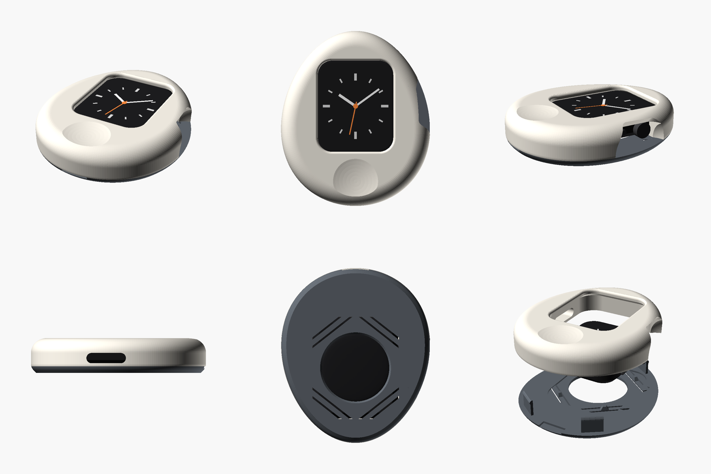

# Egg case for Apple Watch Series 7

A smooth, palm-sized egg that turns an Apple Watch Series 7 (band removed) into a little handheld you can hold, set on a desk, and charge without taking apart. Made for printing on a Bambu Lab P1S, with no supports needed.



It's two printed parts that clip together around the watch:

| Part | What it does |
|---|---|
| **shell** | Domed front. The screen window has a soft rounded edge and a hidden 45° lip that holds the watch by the edge of its glass. Also has a thumb rest below the screen, a cove on the right for the Digital Crown and side button, and a speaker port on the left. |
| **back** | Flat-bottomed back that sits steady on a desk. 4 snap clips, 4 spring pads that push the watch forward so it never rattles, and a hole that lets the magnetic charger reach the watch. |

## Which files to print

Pick the folder for your watch size: `stl/45mm/` or `stl/41mm/` (the size is engraved on the back of the watch).

| File | Print it? |
|---|---|
| `egg_XXmm_fit_test.stl` | **Print this first** (about 20 min). It's just the ring around the watch, so you can check the fit before printing the full shell. |
| `egg_XXmm_shell.stl` | Yes |
| `egg_XXmm_back.stl` | Yes |
| `egg_XXmm_back_tighter.stl` | Only if the watch rattles with the normal back |
| `egg_XXmm_back_looser.stl` | Only if the normal back won't clip on fully |

Or open `3mf/egg_XXmm_plate.3mf` in Bambu Studio to get the shell and back already laid out on one plate.

The files are already oriented for printing. Don't rotate them.
- **shell**: flat seam face down, screen side up.
- **back**: outside face down.

## Print settings (Bambu Lab P1S, 0.4 mm nozzle)

| Setting | Shell | Back |
|---|---|---|
| Filament | PLA (Matte looks great) or PETG | **PETG recommended** (springier clips), PLA works |
| Layer height | 0.12 mm, or 0.2 mm with *Adaptive layer height* on (smoother dome) | 0.2 mm |
| Walls | 6 | 4 |
| Top / bottom layers | 6 / 5 | 5 / 5 |
| Infill | **100 %** for maximum weight (or 40 % gyroid if you want it lighter) | 100 % |
| Supports | **Off**. Every overhang is ≤ 55° or a short bridge. | Off |
| Brim | Off | Off |
| Plate | Textured PEI or Smooth PEI | Textured PEI gives the bottom a nice finish |

Notes:
- The thin spring beams on the back are printed as bridges. Bambu Studio's default bridge settings handle them fine.
- If the front has visible "contour rings" on the dome, use a smaller layer height or adaptive layer height.

## Assembly

1. Take the band off the watch.
2. Lay the shell face-down on a soft cloth.
3. Drop the watch in screen-first, with the **Digital Crown in the cove side** (the crown is on the right when you look at the screen).
4. Line the back up so its charger hole is over the watch's sensor, then press it on until all four clips click.

**Removing it:** put a coin or fingernail in the small slot at the bottom seam and twist. The back pops off.

**Charging:** leave it in the case. The Apple magnetic charging puck (≈27.5 mm) drops into the hole in the back.

## If the fit isn't right

The model is based on Apple's published dimensions (45 × 38 × 10.7 mm and 41 × 35 × 10.7 mm). A few details Apple doesn't publish are estimates: the corner radius, the crystal edge profile, and the crown position. The spring pads absorb about ±0.7 mm of thickness difference. Beyond that:

| Symptom | Fix |
|---|---|
| Watch won't drop into the fit test / shell | Increase `side_clearance` (e.g. 0.30 → 0.40) and re-export |
| Watch wiggles sideways | Decrease `side_clearance` (0.30 → 0.20) |
| Watch rattles front-to-back | Print `back_tighter`, or raise `pad_offset` |
| Back won't clip on, or clips pop off | Print `back_looser`, or lower `pad_offset` |
| Clips too loose / too tight | Change `snap_interference` (0.25 → 0.35 tighter, 0.15 looser) |

To change a parameter: open `egg_case.scad` in [OpenSCAD](https://openscad.org) (free), use the **Customizer** panel, choose the part, then press F6 and export the STL. The Shape section also lets you resize the egg, thicken the back, move the thumb rest, and so on.

## Watch settings that help

- **Wrist Detection off** (Watch app → Passcode). With it on, the watch locks as soon as it's off your wrist.
- **Always On** display on (Display & Brightness).
- **Return to Clock** set to "After 1 hour" or "Always" if you like a particular app on screen.

## Rebuilding the files

```
pip install trimesh lxml manifold3d shapely networkx rtree matplotlib pillow
python3 tools/build.py --previews     # STL + 3MF (+ images)
python3 tools/check.py --size 45      # mesh / fit / overhang / lip checks
```
